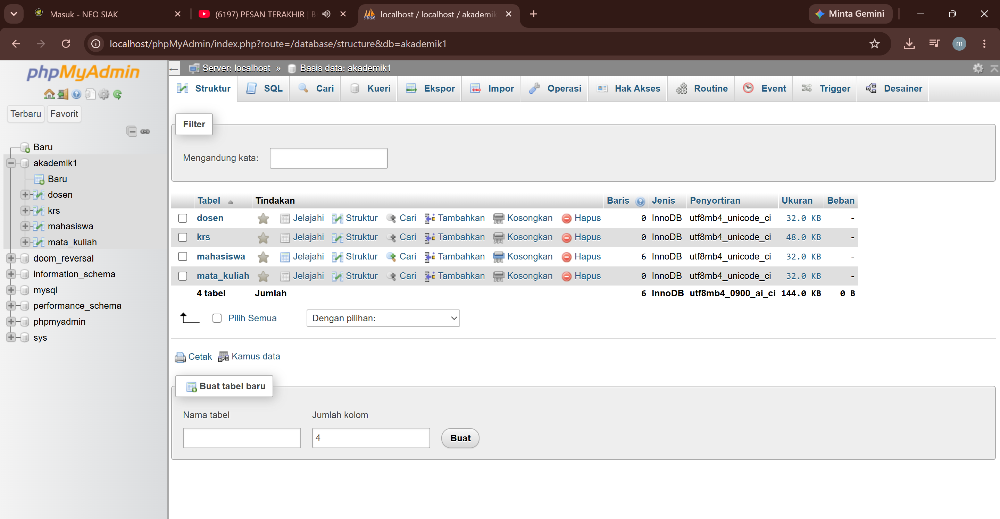
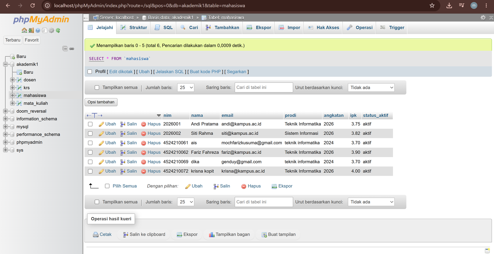
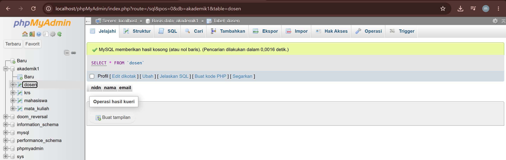
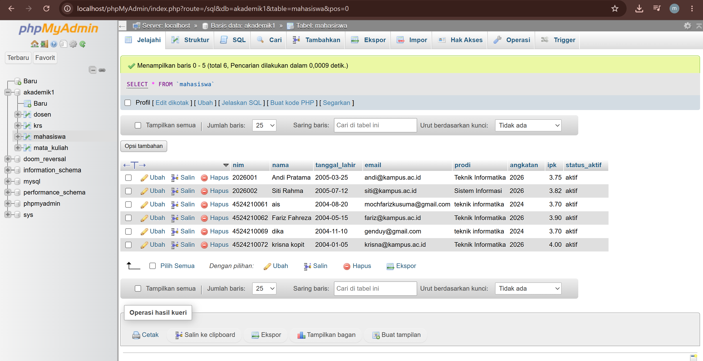
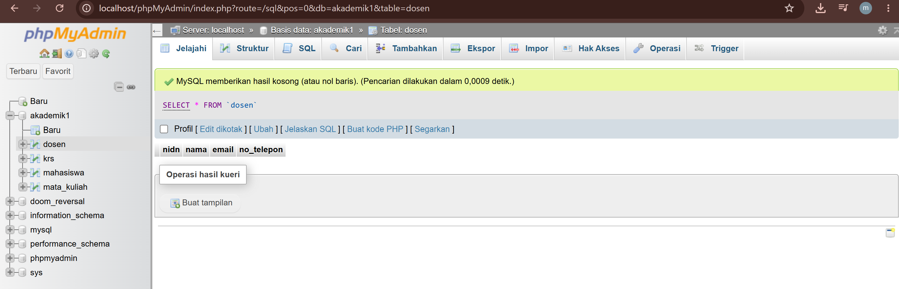
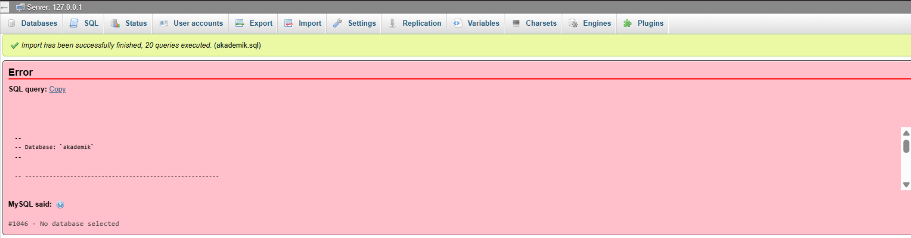

# Laporan Praktikum - Pertemuan 3: Desain & Manipulasi Database

**Informasi Mahasiswa:**
* **Nama:** Muhammad Fariz Fahreza
* **NIM:** 4524210062
* **Matkul:** Prak PBW 

---

## 1. Contoh Pertemuan 3


Seluruh skrip SQL Pertemuan 3 pada pangkalan data `akademik1` telah berhasil dijalankan tanpa error kritis.

### Screenshot Sebelum Modifikasi
### A. Tabel `mahasiswa` Sebelum Modifikasi


### B. Tabel `dosen` Sebelum Modifikasi

> *Keterangan: Menampilkan struktur awal database `akademik1` yang memuat tabel `mahasiswa` tanpa kolom tanggal lahir dan tabel `dosen` tanpa kolom nomor telepon.*

---

## 2. Modifikasi Program

Dua modifikasi struktur tabel (DDL) serta pengisian data (DML) yang ditambahkan pada pangkalan data:

* **Modifikasi 1: Penambahan Kolom `tanggal_lahir` dan Pengisian Data pada Tabel `mahasiswa`**
  * **Penjelasan:** Menambahkan kolom `tanggal_lahir` bertipe data `DATE` setelah kolom `nama` pada tabel `mahasiswa`, serta mengisikan data tanggal lahir untuk masing-masing mahasiswa.
  * **Kueri SQL:**
    ```sql
    -- Menambahkan kolom tanggal_lahir
    ALTER TABLE mahasiswa 
    ADD COLUMN tanggal_lahir DATE AFTER nama;

    -- Pengisian data tanggal lahir mahasiswa
    UPDATE mahasiswa 
    SET tanggal_lahir = CASE nim
        WHEN '2026001'   THEN '2005-03-25'
        WHEN '2026002'   THEN '2005-07-12'
        WHEN '4524210061' THEN '2004-08-20'
        WHEN '4524210062' THEN '2004-05-15'
        WHEN '4524210069' THEN '2004-11-10'
        WHEN '4524210072' THEN '2004-01-05'
    END
    WHERE nim IN ('2026001', '2026002', '4524210061', '4524210062', '4524210069', '4524210072');
    ```

* **Modifikasi 2: Penambahan Kolom `no_telepon` pada Tabel `dosen`**
  * **Penjelasan:** Menambahkan kolom `no_telepon` bertipe data `VARCHAR(15)` pada tabel `dosen` untuk menyimpan kontak pengajar.
  * **Kueri SQL:**
    ```sql
    ALTER TABLE dosen 
    ADD COLUMN no_telepon VARCHAR(15);
    ```

### Screenshot Sesudah Modifikasi
### A. Tabel `mahasiswa` Sesudah Modifikasi


### B. Tabel `dosen` Sesudah Modifikasi

> *Keterangan: Menampilkan struktur tabel `mahasiswa` yang telah memuat kolom `tanggal_lahir` beserta datanya, dan tabel `dosen` yang telah ditambah kolom `no_telepon`.*

---

## 3. Penjelasan Bagian Kode Penting

Berikut adalah 5 bagian kueri SQL paling penting pada file `akademik1.sql` beserta penjelasannya:

1. **`PRIMARY KEY (\`nim\`)` / `PRIMARY KEY (\`nidn\`)`**
   * **Fungsi:** Menentukan kolom sebagai identitas unik utama pada tabel (seperti `nim` di `mahasiswa` dan `nidn` di `dosen`) agar tidak ada duplikasi data.
2. **`FOREIGN KEY (\`nim\`) REFERENCES \`mahasiswa\` (\`nim\`)`**
   * **Fungsi:** Membentuk hubungan (relasi) antar tabel, menghubungkan kolom `nim` pada tabel `krs` ke `nim` yang berada di tabel utama `mahasiswa`.
3. **`ON DELETE CASCADE ON UPDATE CASCADE`**
   * **Fungsi:** Memastikan apabila data induk pada tabel `mahasiswa` diubah atau dihapus, perubahan tersebut otomatis diterapkan pada data terkait di tabel turunan `krs`.
4. **`CONSTRAINT \`uq_krs\` UNIQUE (\`nim\`,\`kode_mk\`,\`semester\`,\`tahun_ajaran\`)`**
   * **Fungsi:** Membatasi kombinasi data KRS agar mahasiswa tidak dapat mengambil mata kuliah yang sama lebih dari sekali pada semester dan tahun ajaran yang sama.
5. **`AUTO_INCREMENT` pada Tabel `krs`**
   * **Fungsi:** Menghasilkan penomoran ID secara otomatis dan berurutan untuk setiap entri KRS baru.

---

## 4. Analisis Error & Langkah Perbaikan


Langkah penanganan error yang sempat ditemui saat proses pengerjaan:

* **Pesan Error:** `#1046 - No database selected`
* **Penyebab:** Melakukan impor berkas SQL tanpa memilih atau membuat database tujuan terlebih dahulu di phpMyAdmin.
* **Solusi Perbaikan:**
  1. Membuat database baru terlebih dahulu dengan nama `akademik1`.
  2. Mengklik nama database `akademik1` pada panel sebelah kiri hingga aktif.
  3. Mengulang kembali proses impor berkas SQL.