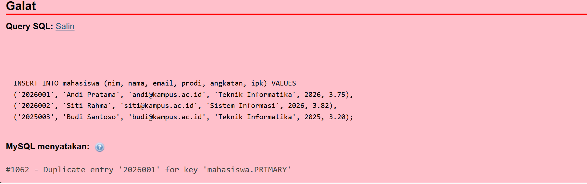

# Laporan Praktikum - Pertemuan 4: Manipulasi & Pengurutan Data Database

**Informasi Mahasiswa:**
- **Nama:** Muhammad Fariz Fahreza
- **NIM:** 4524210062
- **Matkul:** Prak PBW 

---

## 1. Tampilan Awal Database


Tampilan awal tabel `mahasiswa` pada pangkalan data `akademik1` sebelum dilakukan manipulasi data lanjutan.

---

## 2. Modifikasi Data & Pengurutan (DML & DQL)

Pada Pertemuan 4 ini, dilakukan beberapa operasi manipulasi data (DML) serta pengurutan data (DQL) pada tabel `mahasiswa`:

* **Modifikasi 1: Penghapusan Data Mahasiswa (DELETE)**
  * **Penjelasan:** Menghapus data mahasiswa bernama `ais` dari tabel `mahasiswa` menggunakan acuan NIM agar proses penghapusan tepat sasaran.
  * **Kueri SQL:**
    ```sql
    DELETE FROM mahasiswa 
    WHERE nim = '4524210061';
    ```

* **Modifikasi 2: Pengubahan Data Email (UPDATE)**
  * **Penjelasan:** Mengubah data email mahasiswa bernama `dika` dari email lama `genduy@gmail.com` menjadi email kampus resmi `dika@kampus.ac.id`.
  * **Kueri SQL:**
    ```sql
    UPDATE mahasiswa 
    SET email = 'dika@kampus.ac.id' 
    WHERE nim = '4524210069';
    ```

* **Modifikasi 3: Pengurutan Data Berdasarkan IPK Terbesar (ORDER BY DESC)**
  * **Penjelasan:** Menampilkan seluruh baris data mahasiswa yang telah diurutkan dari IPK tertinggi ke terendah (dari 4.00 hingga 3.70).
  * **Kueri SQL:**
    ```sql
    SELECT * FROM mahasiswa 
    ORDER BY ipk DESC;
    ```

---

## 3. Screenshot Hasil Modifikasi & Pengurutan

### A. Tabel `mahasiswa` Setelah Penghapusan & Perubahan Email

> *Keterangan: Menampilkan tabel `mahasiswa` di phpMyAdmin setelah data mahasiswa `ais` dihapus dan email `dika` diperbarui.*

### B. Hasil Pengurutan IPK Mahasiswa Terbesar

> *Keterangan: Menampilkan data mahasiswa yang telah diurutkan berdasarkan IPK tertinggi (`krisna kopit` dengan IPK 4.00 di posisi teratas).*

---

## 4. Analisis Error & Langkah Perbaikan


Langkah penanganan error yang sempat ditemui saat proses pengerjaan:

- **Pesan Error:** `#1062 - Duplicate entry '2026001' for key 'PRIMARY'`
- **Kueri Penyebab:**
  ```sql
  INSERT INTO mahasiswa (nim, nama, email, prodi, angkatan, ipk) VALUES
  ('2026001', 'Andi Pratama', 'andi@kampus.ac.id', 'Teknik Informatika', 2026, 3.75);